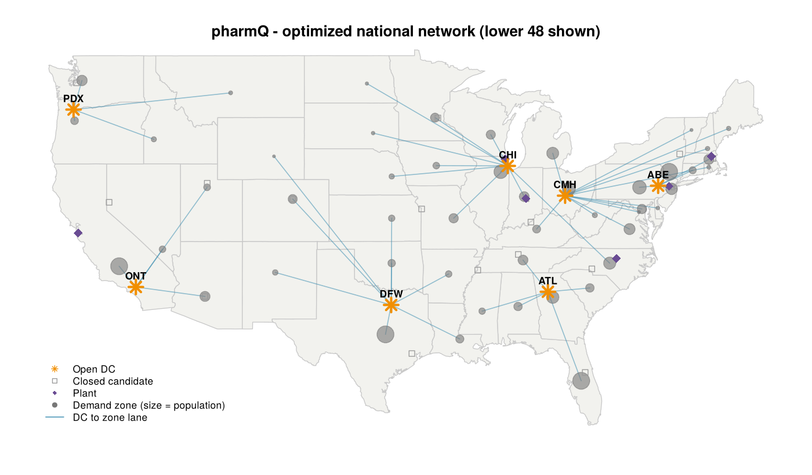
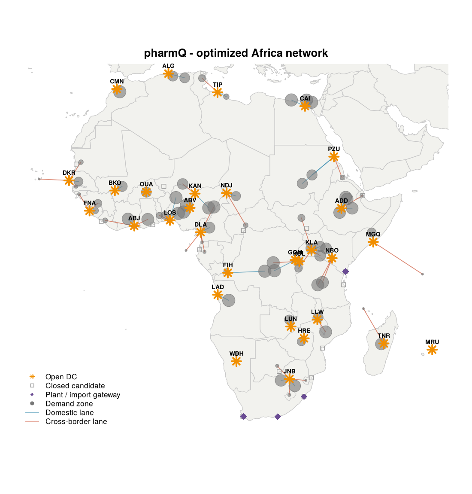

# 💊 pharmQ

**Medicine distribution network & inventory planner for the United States and Africa, in Python and R.**

🌐 **Live demo:** https://augustine-odibo.github.io/pharmQ/

pharmQ models how medicines move **manufacturing plants & import gateways → distribution centers (DCs) → pharmacies and health facilities**. It decides where to put DCs, which DC serves which area, how much stock to hold, and where shortages are most likely. It also lets you stress-test the network with plant or port outages, DC closures and demand surges.

| Region | Coverage | Highlights |
|---|---|---|
| 🇺🇸 **United States** | 50 states + DC + Puerto Rico (2020 Census) | DEA Schedule II vaults, flu / GLP-1 scenarios |
| 🌍 **Africa** | all 54 countries (2024 UN estimates) | cross-border customs cost & delay, slower roads, seaport & air import gateways, malaria / HIV / TB / maternal-health medicines, island states served by air |

| United States | Africa |
|---|---|
|  |  |

| | Python | R |
|---|---|---|
| Model library | `pharmq/` (pip package + `pharmq` CLI) | `r/pharmqR/` (R package) |
| Web app | Streamlit: `app/streamlit_app.py` | Shiny: `r/shiny/app.R` |
| Network solver | Exact MILP (SciPy HiGHS) + fast heuristic | Heuristic + lpSolve MILP |
| Forecasting | Holt-Winters (additive / multiplicative, auto) | `stats::HoltWinters` (auto) |
| Tests | `pytest` (19 tests) | `testthat` (25 expectations) |

Both implementations read the same reference data and use the same formulas, so you can work in whichever language your team prefers.

---

## What the model does

1. **Demand.** Each state or country is split into demand zones, and very populous countries (Nigeria, Ethiopia, Egypt, DR Congo and others) are split automatically. Annual demand per SKU = population × per-capita prescribing rate × local variation. Pharmacies are estimated at about 19 per 100k residents.
2. **Forecast.** Builds 3 years of weekly history per SKU and fits Holt-Winters, choosing additive or multiplicative seasonality by 13-week back-test (WAPE, MAPE, bias). It reports 26-week forecasts with 95% intervals.
3. **Network design** (capacitated facility location):
   - chooses which candidate DCs to open, trading DC fixed cost against inbound (plant → DC) and outbound (DC → zone) freight
   - each zone × handling class (**ambient / cold chain 2–8 °C / DEA Schedule II**) is single-sourced
   - cold freight only goes to refrigerated DCs and Schedule II only to DEA-vault DCs
   - air freight is used for islands (Alaska, Hawaii, Puerto Rico; Madagascar, Mauritius, Cabo Verde, Comoros, São Tomé, Seychelles) and lanes that are too long for ground or cold-chain
   - **crossing a national border** adds a customs clearance cost per pack and customs delay days (Africa defaults: $0.012/pack, 4 days); roads are modelled as longer and slower than straight lines (Africa: 1.45× at 250 mi/day)
   - DCs can be forced open or closed, and the DC count can be bounded
4. **Inventory policy** per DC × SKU: safety stock with demand and lead-time uncertainty, reorder point, EOQ capped by shelf life, plus peak-season values.
5. **Simulation.** A 365-day stochastic run with seasonal demand, random lead times, FEFO lot picking with expiry write-offs, and optional plant outages that fail over to backup plants.
6. **Shortage risk.** A 0–100 score per SKU built from single sourcing, service gap, volatility, lead-time variability, handling complexity and shelf-life pressure.

Baseline results (bundled data, exact solver):

| | DCs | Network cost / yr | Cost per pack | Reach ≤ 2 days | Cross-border volume | Fill rate |
|---|---|---|---|---|---|---|
| United States | 11 | $184M | $0.10 | 94% | n/a | 99.7% |
| Africa | 30 | $505M | $0.25 | 53% | 22% | 99.7% |

> ⚠️ Populations are real (US 2020 Census; Africa 2024 UN World Population Prospects estimates). Costs, capacities, per-capita use and lead times are **illustrative**. Replace them with your own data before using results for real decisions.

---

## Quick start

### Python
```bash
git clone https://github.com/<you>/pharmQ.git && cd pharmQ
python -m venv .venv && source .venv/bin/activate      # Windows: .venv\Scripts\activate
pip install -r requirements.txt && pip install -e ".[dev]"

streamlit run app/streamlit_app.py                     # web app → http://localhost:8501
pharmq run --config config/default.toml --out results  # CLI, United States: writes CSVs + summary.json
pharmq run --region africa --out results_africa        # CLI, Africa
pytest -q                                              # tests
```

```python
from pharmq import Config, Outage, run

res = run(Config(service_level=0.99, force_closed=["DC-MEM"]),
          outage=Outage("PL-NJ", start_day=30, duration_days=90))

africa = run(Config(region="africa", border_delay_days=6),          # region defaults + your overrides
             outage=Outage("GW-MBA", start_day=30, duration_days=90))  # Mombasa port closure
print(res.summary())
res.solution.open_sites      # which DCs, utilization
res.solution.lanes           # DC → zone assignments, miles, mode, cost
res.policy                   # safety stock / reorder point / order qty
res.risk                     # shortage risk ranking
res.export("results/")
```

### R
```r
# from the repo root
install.packages(c("shiny", "lpSolve", "maps", "jsonlite", "testthat"))
install.packages("r/pharmqR", repos = NULL, type = "source")

library(pharmqR)
res <- pq_run(pq_config(service_level = 0.99), outage = pq_outage("PL-NJ", 30, 90))
africa <- pq_run(pq_config("africa"), outage = pq_outage("GW-MBA", 30, 90))
res                      # prints KPIs
res$solution$open_sites
pq_export(res, "results_r")

shiny::runApp("r/shiny")    # web app
```

### Docker (both apps at once)
```bash
docker compose up --build
# Python/Streamlit → http://localhost:8501
# R/Shiny          → http://localhost:3838/pharmq/
```

---

## Deploy

| Where | How |
|---|---|
| **Streamlit Community Cloud** (free) | Push to GitHub → share.streamlit.io → *New app* → repo `pharmQ`, main file `app/streamlit_app.py`. |
| **shinyapps.io** (free tier) | `rsconnect::deployApp("r/shiny")`. Install `pharmqR` first, or remove the package check so the app sources `../pharmqR/R`. |
| **Render / Railway / Fly.io / Cloud Run** | Point them at the `Dockerfile` (port 8501) or `Dockerfile.shiny` (port 3838). |
| **Posit Connect** | Publish `r/shiny` or `app/streamlit_app.py` directly. |

CI (`.github/workflows/ci.yml`) runs on every push. It lints and tests Python on 3.11–3.13, smoke-tests the Streamlit app, tests the R package, checks that the Python and R data copies match, and builds the Docker image.

---

## Use your own data

Every table can be swapped out: upload it in either app's sidebar, pass it to the CLI (`--sites`, `--products`, `--plants`, `--zones`), or pass a DataFrame in code. Column definitions are in **[docs/DATA_SCHEMA.md](docs/DATA_SCHEMA.md)**, and you can download templates from the app's *Data & export* tab.

Ideas for real-world inputs:
- **United States:** Census ACS (population by county), CMS Part D prescriber data (prescribing rates), FDA NDC directory (products), FDA drug shortage list (risk validation), DEA ARCOS (controlled-substance flows).
- **Africa:** national medical stores and Central Medical Stores warehouse lists, Global Fund / USAID GHSC-PSM consumption and price data, WHO/UNICEF immunization schedules and vaccine forecasts, Africa CDC / AMA manufacturing registries, port dwell-time and border-crossing studies, plus your own distributor and freight contracts.

## Configuration

All knobs are in `config/default.toml` (United States) and `config/africa.toml`: region, zones per state/country, subset, demand surges, solver, DC limits, forced sites, freight rates, road speed and circuity, border cost and customs delay, air rules, service level, holding and ordering cost, shelf-life cap, and simulation length. Settings you don't set take the region's defaults. Both apps have a **region switch** and one-click **scenario presets**:

- **United States:** severe flu season, New Jersey plant outage, Columbus + Allentown hubs closed, GLP-1 demand doubling.
- **Africa:** severe malaria season, Mombasa port closure, Addis Ababa air-gateway outage, Lagos + Nairobi hubs closed, R21 malaria-vaccine scale-up.

**Add another region** (Europe, India, a single country...) by creating `pharmq/data/<region>/` with the four CSVs and adding an entry to `REGION_DEFAULTS` in `pharmq/config.py` (and `PQ_REGIONS` in `r/pharmqR/R/data.R`).

## Project layout
```
pharmQ/
├── pharmq/                 Python package
│   ├── data/usa/           reference CSVs: states, DC sites, plants, products
│   ├── data/africa/        reference CSVs: 54 countries, hubs, plants & import gateways, medicines
│   ├── data.py  geo.py  config.py
│   ├── network.py          facility location (MILP + heuristic)
│   ├── forecast.py         Holt-Winters
│   ├── inventory.py        safety stock / ROP / EOQ
│   ├── simulation.py       stochastic daily simulation with expiry & outages
│   ├── risk.py             shortage-risk scoring
│   ├── pipeline.py         end-to-end run + export
│   └── cli.py
├── app/streamlit_app.py    Python web app
├── r/pharmqR/              R package (same model)
├── r/shiny/app.R           R web app
├── tests/                  pytest suite
├── config/default.toml  config/africa.toml
├── Dockerfile  Dockerfile.shiny  docker-compose.yml
└── .github/workflows/ci.yml
```

## License
MIT. See [LICENSE](LICENSE).
